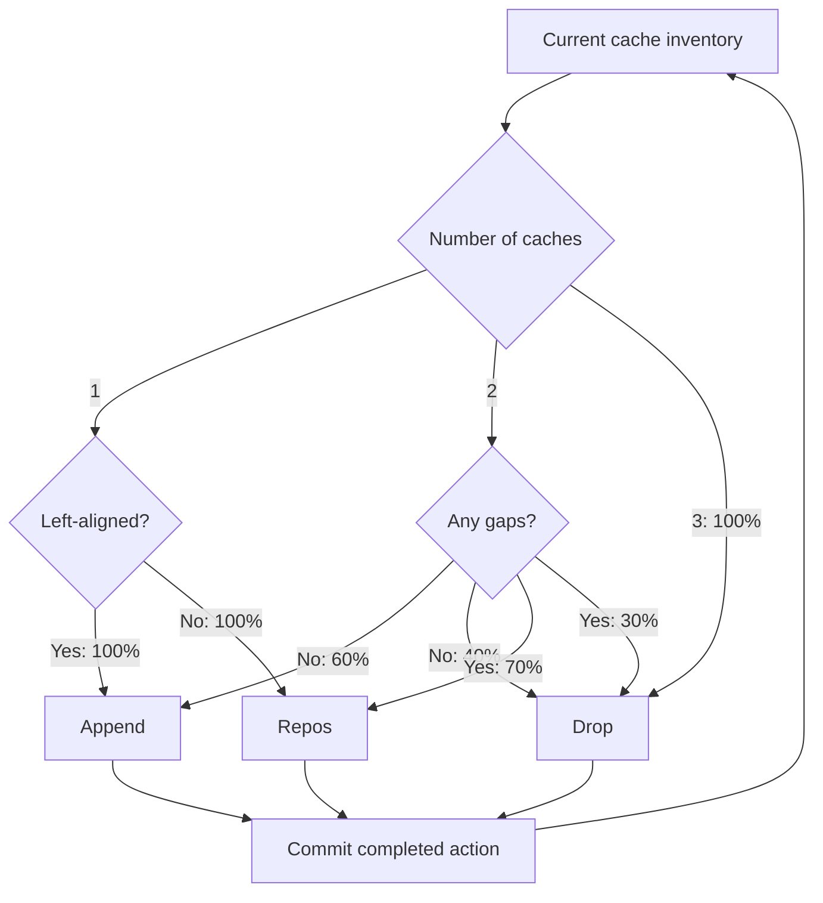
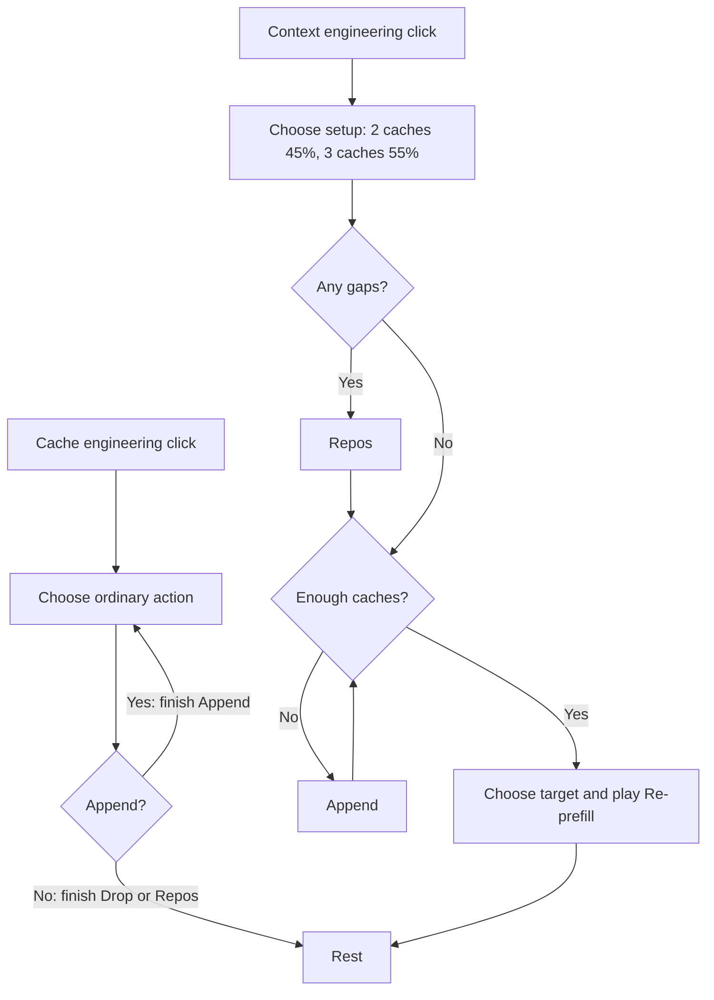

# Cache behavior policy

The resting state is an ordered list of occupied slots: `[193, 256, 319]` are the three available SVG x coordinates. Start with `[193, 256]`. Choose an operation from the current inventory, then choose its target once. Animation frames never draw random numbers.

## Ordinary actions

An ordinary bot click traverses this tree once. The tree describes available transitions, not autoplay. One cache is never dropped; Append never fills a hole or extends beyond the third slot. Repos only runs when the inventory has a gap, including an empty first slot.

## Removal target

Probabilities are conditional on an action being selected. With two caches, “first” and “last” refer to the remaining caches, even if their slots have a gap.

| Action | Cache count | First | Middle | Last |
| --- | ---: | ---: | ---: | ---: |
| Drop | 2 | 90% | — | 10% |
| Drop | 3 | 40% | 50% | 10% |
| Re-prefill | 2 | 95% | — | 5% |
| Re-prefill | 3 | 45% | 50% | 5% |

Drop removes exactly the chosen cache; every retained cache stays in place. Repos shakes first, then compacts the retained caches without changing their order or count.

Re-prefill removes the chosen cache, preserves all preceding KV, and collapses/rebuilds only the suffix. The rebuilt suffix starts at the vacated position. Selecting the last cache has no suffix to invalidate: it finishes after removal, without a false collapse or recomputation gesture.

## Card requests

Choose the Context setup size once per click. An existing three-cache inventory stays at three even if the sampled target is two. Preparation never removes cache. Management finishes its first non-Append action; Context finishes its Re-prefill, including any necessary Repos/Append preparation.

Rapid clicks queue complete requests FIFO. State commits only after each gesture ends. Offscreen/hidden playback pauses. Reduced motion drains the same transitions immediately. Append/Drop take 3 seconds, Repos 3.5 seconds, and Re-prefill 7.5 seconds (3 seconds when editing the tail).

`state.js` contains the probabilities and queue; `scene.js` only renders the chosen action. Inject a random function into `AKVMemoryBotPlayback(false, random)` for reproducible tests.
